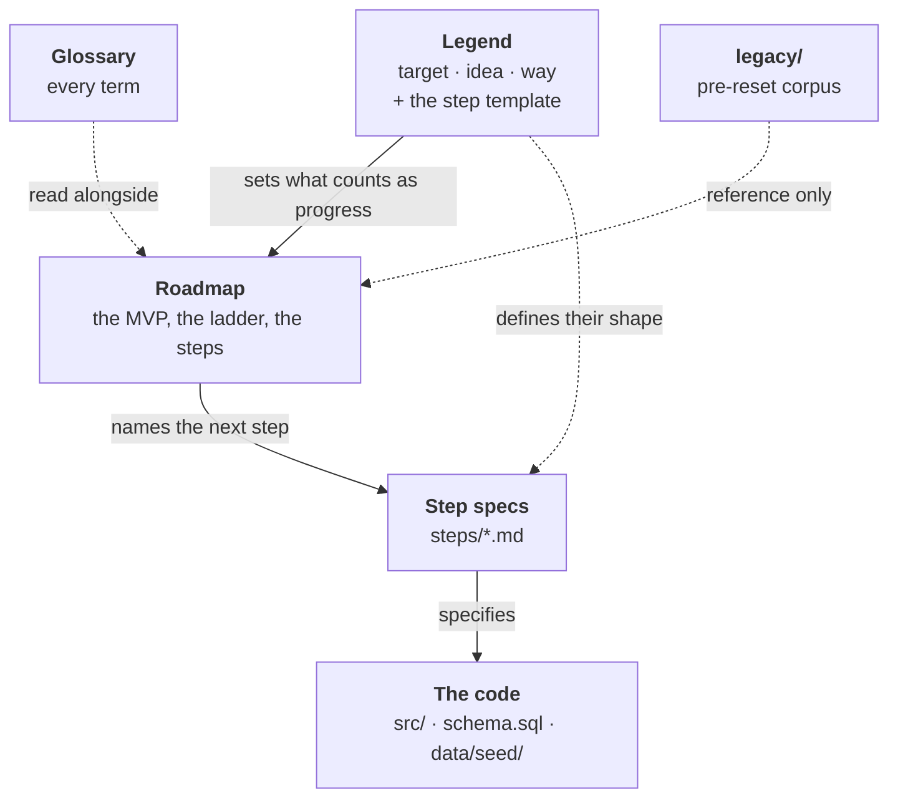

# FortuneTeller documentation

**Start here.** This page is the way in for a new person or a fresh agent session: what to read,
what to run, and which document answers which question.

> Given an event, say what followed past events of its kind, for the markets people feel, with the
> record beside every answer. An entertainment tool with a realistic approach, not financial advice.

## Your first hour

**1. Read five documents, in this order.**

| # | Read | To learn | Time |
| --- | --- | --- | --- |
| 1 | [Legend](legend.md) | The target, the bet behind it, the four claims that must hold, and the template every step document follows | 15 min |
| 2 | [Roadmap](roadmap.md) | What gets built, in what order, and which steps are done | 15 min |
| 3 | [Status](status.md), its first three sections | The last task finished, the one in progress, the next one | 5 min |
| 4 | [Glossary](glossary.md), "The product" and "Project shorthand" | The words the other documents lean on: flow, link, kind, trigger, step, rung | 10 min |
| 5 | [Decisions](decisions.md), the first few | What was settled on purpose, and why, so it is not argued again | 10 min |

**2. Run three commands** from the repo root.

- **uv sync** installs Python 3.12 and every dependency.
- **just check** runs lint, type checks and tests, the same gate as CI. It needs no keys.
- **uv run fortuneteller --help** lists every command and what it prints. Loading real data needs
  a free FRED key; [Accounts](accounts.md) lists every key and where to get it.

**3. Study one spec.** [A CEO's conduct in question](steps/ceo-scandals.md) shows the shape every
step takes: the goal, the obstacle, the rule fixed before anything is measured, steps you can
check, how you know it is right, what it does not do, and the technical details last.

**4. Read the working rules.** [CLAUDE.md](../CLAUDE.md) holds the agreements for anyone changing
the repo, human or agent: the 2026-08-05 reset and the three rules it left.

## The chain

The core documents are one argument, narrowing from why to what exactly. Each answers the question
the one before it raises.

1. **Why does this exist, and why could it work?** The [Legend](legend.md) states the idea so that
   it can fail: four claims must hold, and each is tested by a named part of the plan.
2. **So what do we build, in what order?** The [Roadmap](roadmap.md): the MVP, the feature ladder,
   then the numbered steps. Each ends in a command that prints a real number.
3. **So what are we doing right now?** [Status](status.md) names the task, and its spec in
   [steps/](steps/) says exactly what it is.
4. **What did we find?** Each spec's Results section; [MVP results](mvp-results.md) gathers them
   in plain words.

Each document constrains the one below it. The Glossary and legacy/ are consulted from anywhere and
drive nothing.

## Find what you need

| If you want to… | Read |
| --- | --- |
| Understand the point of the project | [Legend](legend.md), the target and the idea |
| Know why the plan is ordered this way | [Legend](legend.md), the way and the four claims |
| See what gets built and what is done | [Roadmap](roadmap.md) |
| Know what is being worked on now | [Status](status.md) |
| See every finished task, with its pull request | [Changelog](changelog.md) |
| Write the spec for a new step | [Legend](legend.md), what every step document must say |
| Know why something was decided, and whether it is settled | [Decisions](decisions.md), newest first |
| Know what the findings are | [MVP results](mvp-results.md), then each spec's Results |
| Add an event flow or an expectation source | [Extending](extending.md) |
| Know what a table or column means | [Schema](schema.md) |
| Know what was simplified, and what would be more precise | [Precision](precision.md) |
| Know which external services and keys are needed | [Accounts](accounts.md) |
| Find a free data source | [Data sources](data-sources.md), about 250, graded |
| See the kinds of shocks the product should one day answer | [Scenarios](scenarios.md), hypotheses to measure |
| Look up a term or ticker | [Glossary](glossary.md) |
| Know what the reference CSVs contain | [legacy/data/](legacy/data/README.md), still accurate |
| Understand what was abandoned, and why | [legacy/](legacy/README.md) |

## Where things are

| Path | Holds |
| --- | --- |
| docs/ | The current documents, listed above. |
| docs/steps/ | One spec per step: the MVP's, the ladder's rungs and the numbered roadmap steps. |
| docs/scoreboard/ | The published page, rewritten by the evening job and served by GitHub Pages. |
| docs/legacy/ | The pre-reset design corpus. Reference, not instructions. |
| data/seed/ | The committed reference CSVs the code reads. |
| data/triggers/, data/guesses/ | Triggers and guesses, each added through a pull request. |
| schema.sql | The table definitions as plain SQL; their meaning is in [Schema](schema.md). |
| src/fortuneteller/ | The package: config, models, store, flows, study, CLI. |
| [../CLAUDE.md](../CLAUDE.md) | Working agreements for this repo, including the reset note. |

## Where we are

[Status](status.md) always has it. This page does not repeat it, so it cannot go stale.

## How this folder grows

Flat until it needs not to be. A subfolder appears when a second document of the same kind exists,
not in advance; steps/ appeared that way. The likely next one:

- concepts/: one file per idea that needs more than a glossary line (surprise, base rate,
  walk-forward).

Two rules, both learned the hard way: **a document is written when something real needs it**, and
**deleted when it stops being true**. legacy/ exists because the last corpus drifted into describing
code that did not exist, which is worse than having no documentation at all.
